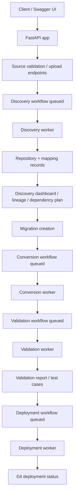

# ETL-CC API Flow and VS Code Runbook

This document describes the real API flow implemented in this repository and how to run the application from VS Code and invoke it through Swagger UI.

## 1. Repository architecture at a glance

The project is a FastAPI application with a PostgreSQL-backed workflow engine.

Key files:

- API app entry: `src/etl_cc/main.py`
- Route definitions: `src/etl_cc/api.py`
- Runtime settings: `src/etl_cc/config.py`
- Discovery worker: `src/etl_cc/worker.py`
- Conversion worker: `src/etl_cc/conversion_worker.py`
- Validation worker: `src/etl_cc/validation_worker.py`
- Deployment worker: `src/etl_cc/deployment_worker.py`
- Database config and session handling: `src/etl_cc/database.py`
- Request/response schema: `src/etl_cc/models.py`

The FastAPI app is mounted under the API prefix configured in `settings.api_prefix`, which defaults to `/api/v1`.

Swagger UI is exposed at:

- `http://127.0.0.1:8000/docs`
- OpenAPI schema: `http://127.0.0.1:8000/openapi.json`

---

## 2. How the system starts

### 2.1 Prerequisites

Before starting the app:

1. Install Python dependencies:

```powershell
pip install -r requirements.txt
```

2. Make sure the project root has a valid `.env` file with database and Azure/OpenAI settings.

3. Ensure the PostgreSQL database is running and reachable.

### 2.2 Start the API from VS Code

From the project root in a VS Code terminal:

```powershell
Set-Location 'c:/Users/viaan.sharma/ETL-CC'
$env:PYTHONPATH = 'src'
$env:ENABLE_AB_INITIO = "true"
uvicorn etl_cc.main:app --app-dir src --reload

```

If you do not need an explicit `PYTHONPATH`, the project also supports:

```powershell
Set-Location 'c:/Users/viaan.sharma/ETL-CC'
uvicorn etl_cc.main:app --app-dir src --reload
```

Once started, open:

```text
http://127.0.0.1:8000/docs
```

> Important: In PowerShell, use `$env:PYTHONPATH = 'src'` rather than Unix-style `PYTHONPATH=src` syntax.

---

## 3. System runtime flow

The repo implements a queued workflow model. API requests create workflows and status records; separate worker processes process them asynchronously.



The main business flow is:

1. Query available ETL products and ingestion methods.
2. Validate or upload a source.
3. Start discovery.
4. Inspect repositories / mappings / workflow status.
5. Start migration or conversion.
6. Run validation.
7. Execute deployment.

---

## 4. API route structure

All routes are mounted under `/api/v1` by default.

### 4.1 Application and health

- `GET /` — app root status
- `GET /api/v1/health` — health check
- `GET /api/v1/etl-products` — available ETL products and ingestion methods

### 4.2 Source ingestion and analysis

These endpoints validate external source access and parse uploaded files.

- `POST /api/v1/sources/powercenter/test`
- `POST /api/v1/sources/github/test`
- `POST /api/v1/sources/xml/analyze`
- `POST /api/v1/sources/ab-initio/analyze`

Typical usage:

- Use `GET /api/v1/etl-products` to discover enabled source types.
- Then call the matching source-analysis endpoint to validate credentials or upload XML/graph data.

### 4.3 Discovery

Discovery is the ingestion and mapping analysis phase.

- `POST /api/v1/discoveries` — starts a discovery workflow
- `GET /api/v1/repositories` — list repositories
- `GET /api/v1/repositories/{repository_id}` — one repository
- `GET /api/v1/repositories/{repository_id}/mappings` — repository mappings
- `GET /api/v1/repositories/{repository_id}/discovery-summary` — aggregate readiness summary
- `GET /api/v1/repositories/{repository_id}/discovery-dashboard` — full discovery dashboard
- `GET /api/v1/mappings/{etl_object_id}/discovery` — mapping discovery details
- `GET /api/v1/mappings/{etl_object_id}/lineage` — lineage details
- `GET /api/v1/workflows/{workflow_id}` — workflow status
- `GET /api/v1/workflows/{workflow_id}/events` — workflow events
- `GET /api/v1/workflows/{workflow_id}/events/stream` — server-sent events stream

### 4.4 Conversion and migration

- `POST /api/v1/migrations` — starts migration orchestration
- `GET /api/v1/migrations/{migration_id}/dashboard` — migration dashboard
- `GET /api/v1/migrations/{migration_id}/mappings/{etl_object_id}/business-rules` — business rules
- `GET /api/v1/migrations/{migration_id}/mappings/{etl_object_id}/lineage` — migration lineage
- `POST /api/v1/conversions` — starts conversion workflow
- `GET /api/v1/conversions/{workflow_id}` — conversion status
- `GET /api/v1/conversions/{workflow_id}/mappings` — conversion mappings
- `GET /api/v1/conversions/{workflow_id}/workbench/{etl_object_id}` — workbench snapshot
- `GET /api/v1/mappings/{etl_object_id}/conversion` — conversion info
- `GET /api/v1/mappings/{etl_object_id}/artifacts` — generated artifacts
- `GET /api/v1/artifacts/{artifact_id}` — artifact content

### 4.5 Validation

- `POST /api/v1/validations/datasets` — upload validation dataset
- `POST /api/v1/validation-database-connections` — add validation DB connection
- `POST /api/v1/validations` — queue validation workflow
- `GET /api/v1/validations/{workflow_id}` — validation status
- `GET /api/v1/validations/{workflow_id}/mappings` — validation mapping results
- `GET /api/v1/validations/{workflow_id}/report` — aggregate validation report
- `GET /api/v1/validations/{workflow_id}/test-cases` — validation test cases
- `POST /api/v1/validations/{workflow_id}/data-comparison` — compare legacy and PySpark outputs

### 4.6 Deployment

- `POST /api/v1/deployment-targets/github/test` — test GitHub deployment target
- `POST /api/v1/deployment-targets/github` — save GitHub deployment target
- `GET /api/v1/deployment-targets` — list deployment targets
- `GET /api/v1/deployment-targets/{target_repository_id}` — one target
- `POST /api/v1/deployments` — queue a deployment workflow
- `GET /api/v1/deployments/{workflow_id}` — deployment status
- `GET /api/v1/deployments/{workflow_id}/mappings` — deployment mapping results

---

## 5. Recommended end-to-end API flow for Swagger use

Use the following order in Swagger UI.

### Step 1 — Check app health

- Open `/docs`
- Call `GET /api/v1/health`
- Expected:

```json
{"status":"ok"}
```

### Step 2 — Discover available source options

- Call `GET /api/v1/etl-products`
- Review which ETL products and ingestion methods are enabled.

### Step 3 — Analyze a source

Use one of these endpoints:

- `POST /api/v1/sources/powercenter/test`
- `POST /api/v1/sources/github/test`
- `POST /api/v1/sources/xml/analyze`
- `POST /api/v1/sources/ab-initio/analyze`

This returns a source-analysis payload and creates the source metadata required by discovery.

### Step 4 — Start discovery

- Call `POST /api/v1/discoveries`
- Pass the required source ID, connection details, and selected mapping keys if needed.
- This creates a queued discovery workflow.

### Step 5 — Track workflow execution

- Use `GET /api/v1/workflows/{workflow_id}` to view status.
- Use `GET /api/v1/workflows/{workflow_id}/events/stream` for live progress.
- Review `GET /api/v1/repositories/{repository_id}/discovery-dashboard` after completion.

### Step 6 — Inspect discovered mappings

- `GET /api/v1/repositories/{repository_id}/mappings`
- `GET /api/v1/mappings/{etl_object_id}/discovery`
- `GET /api/v1/mappings/{etl_object_id}/lineage`
- `GET /api/v1/workflows/{workflow_id}/dependency-plan`

### Step 7 — Start migration and conversion

- Call `POST /api/v1/migrations` to create the migration and queue its conversion.
- Poll the `conversion_workflow_id` returned by that response. Do not also call
  `POST /api/v1/conversions` for the same mappings; that creates a separate conversion.
- If starting a conversion independently, provide its parent `migration_id` in the
  request body when it should participate in migration validation and deployment.

The migration endpoint creates and links its conversion job. A direct conversion request
creates a separate job; include `migration_id` when it belongs to an existing migration.
The actual conversion processing happens in the conversion worker, not directly in the API response.

### Step 8 — Track conversion execution

- `GET /api/v1/conversions/{workflow_id}`
- `GET /api/v1/conversions/{workflow_id}/mappings`
- `GET /api/v1/conversions/{workflow_id}/workbench/{etl_object_id}`

This is the conversion-phase checkpoint before validation.

### Step 9 — Run validation

- `POST /api/v1/validations/datasets` to stage datasets
- `POST /api/v1/validation-database-connections` for a DB connection if needed
- `POST /api/v1/validations`
- Check results with:
  - `GET /api/v1/validations/{workflow_id}`
  - `GET /api/v1/validations/{workflow_id}/mappings`
  - `GET /api/v1/validations/{workflow_id}/report`
  - `GET /api/v1/validations/{workflow_id}/test-cases`

### Step 10 — Deploy to Git

- `POST /api/v1/deployment-targets/github/test`
- `POST /api/v1/deployment-targets/github`
- `POST /api/v1/deployments`
- Use `GET /api/v1/deployments/{workflow_id}` to track deployment progress.

---

## 6. Typical practical workflow

The repo is designed to support this real operational route:

```text
GET /etl-products
  -> POST /sources/*/test or /sources/*/analyze
  -> POST /discoveries
  -> GET /repositories/{id}
  -> GET /workflows/{workflow_id}/events/stream
  -> GET /repositories/{id}/discovery-dashboard
  -> POST /migrations
  -> GET /conversions/{workflow_id} (use the migration response's conversion_workflow_id)
  -> POST /validations
  -> GET /validations/{workflow_id}/report
  -> POST /deployments
```

That is the standard end-to-end lifecycle implemented in the current codebase.

---

## 7. What runs in the background

The API itself is only the front door. The actual heavy processing is done by workers.

### Discovery worker

Process responsibility:

- claims queued `DISCOVERY` jobs
- loads mappings from source
- canonicalizes mappings
- runs discovery + lineage + dependency analysis
- updates repository and mapping records

Entry point:

- `src/etl_cc/worker.py`

### Conversion worker

Process responsibility:

- claims queued `CONVERSION` jobs
- turns discovered mappings into converted artifacts and workbench outputs
- updates conversion workflow progress and mapping-level artifacts
- can trigger downstream validation when the migration flow is set up to do so

Entry point:

- `src/etl_cc/conversion_worker.py`

### Validation worker

Process responsibility:

- claims queued `VALIDATION` jobs
- loads validation context and data
- runs zero-touch validation logic
- stores test cases and validation reports

Entry point:

- `src/etl_cc/validation_worker.py`

### Deployment worker

Process responsibility:

- claims queued `DEPLOYMENT` jobs
- prepares artifacts
- materializes deployable files
- pushes to Git branches and creates deployment records

Entry point:

- `src/etl_cc/deployment_worker.py`

You may need to run these workers in separate terminals for full end-to-end processing.

---

## 8. VS Code execution checklist

Use this checklist in VS Code:

1. Open the project folder in VS Code.
2. Open terminal in the repo root.
3. Run:

```powershell
pip install -r requirements.txt
Set-Location 'c:/Users/viaan.sharma/ETL-CC'
$env:PYTHONPATH = 'src'
uvicorn etl_cc.main:app --app-dir src --reload
```

4. Open `http://127.0.0.1:8000/docs`
5. If full background processing is required, open additional terminals and start the workers in this order:

```powershell
Set-Location 'c:/Users/viaan.sharma/ETL-CC'
$env:PYTHONPATH = 'src'
python -m etl_cc.worker
```

```powershell
Set-Location 'c:/Users/viaan.sharma/ETL-CC'
$env:PYTHONPATH = 'src'
python -m etl_cc.conversion_worker
```

```powershell
Set-Location 'c:/Users/viaan.sharma/ETL-CC'
$env:PYTHONPATH = 'src'
python -m etl_cc.validation_worker
```

```powershell
Set-Location 'c:/Users/viaan.sharma/ETL-CC'
$env:PYTHONPATH = 'src'
python -m etl_cc.deployment_worker
```

6. Test the endpoints in order.

---

## 9. Swagger usage tips

- Use the `Try it out` button for each endpoint.
- For file uploads, use the file selector in Swagger.
- For object bodies, enter realistic values based on the schema.
- For discovery workflows, use the actual source ID / manifest values returned by the source-analysis step.
- Keep the workflow IDs from the response payloads for polling and tracking.

---

## 10. Common startup note

The earlier startup issue is caused by PowerShell syntax differences. This project must be launched with PowerShell environment assignments like:

```powershell
$env:PYTHONPATH = 'src'
```

not:

```powershell
PYTHONPATH=src
```

This matters when running from VS Code terminals on Windows.

---

## 11. Summary

The application is a FastAPI-backed ETL migration command center with a queue-driven workflow model. The main business sequence is:

- source validation
- discovery
- conversion
- validation
- Git deployment

The correct user path in VS Code is to start the API from the project root, then start the discovery, conversion, validation, and deployment workers in separate terminals, and then call the endpoints through Swagger UI at `/docs`.
