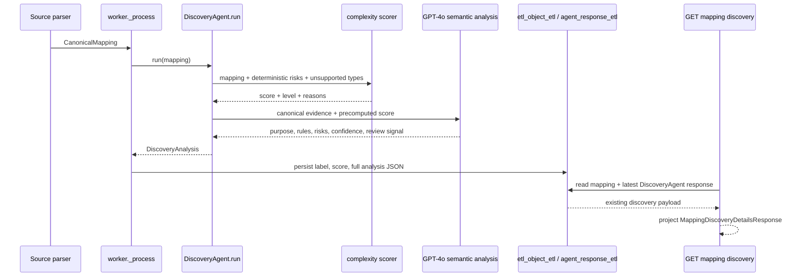
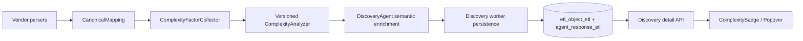
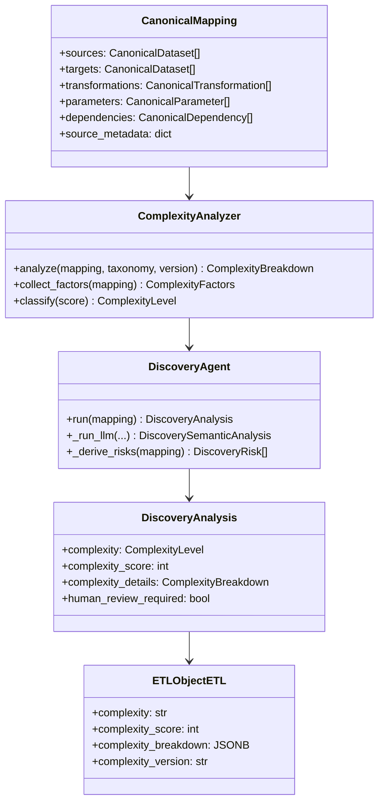

# Complexity Explainability: Code-Level Design

## Executive Recommendation

Implement explainability as a deterministic, versioned analysis of the existing canonical mapping. Keep `DiscoveryAgent` responsible for semantic discovery, and move its deterministic score calculation into a small pure module such as `etl_cc/complexity.py`. Persist the normalized factor breakdown beside the existing mapping score, return it from the existing discovery-detail API, and display it in an accessible popover anchored to the inventory badge.

Do not silently replace the current scoring bands with the example's three-band thresholds. The live code has four levels and different boundaries. First expose exactly what the current score means; any new business weights or thresholds should be a separately approved scoring version with explicit recomputation and reporting.

## 1. Current Flow and Exact Scoring

`DiscoveryAgent.run(mapping)` in `agents/discovery_agent.py` computes a `TransformationSummary`, derives deterministic business rules, prerequisites, risks and unsupported construct names, then calls `_calculate_complexity(mapping, risks, unsupported)`. That calculation happens before and independently of the GPT-4o semantic call. The LLM receives the already-computed level and score as evidence; it does not calculate the stored score.

Current score, clamped to 100:

| Component | Current points | Cap |
| --- | ---: | ---: |
| Base | 10 | 10 |
| Transformations | 2 per transformation | 24 |
| Additional source/target datasets beyond two | 3 each | 12 |
| Deterministic medium-risk entries | 5 each | 20 |
| Deterministic high/critical-risk entries | 10 each | 30 |
| Parameters | 2 each | 8 |
| `mapping.dependencies` | 4 each | 12 |
| Unsupported construct types | 15 each | 30 |

Bands are `0-30 LOW`, `31-55 MEDIUM`, `56-80 HIGH`, and `81-100 VERY_HIGH`. The requested example's `71-100 HIGH` is not the current contract. The formula can count an unsupported construct both as a high-risk transformation and as unsupported; SQL properties can add another high-risk entry. Preserve and make those contributions visible in a compatibility version, or intentionally eliminate overlap in a new scoring version.

`complexity_reasons` currently explains only transformation count, extra datasets and medium/high risk-entry counts. It omits parameter, dependency and unsupported points. `DiscoveryAgent._calculate_confidence()` is defined but not used by `run()`: the response `confidence` comes from `DiscoverySemanticAnalysis.confidence` returned by the LLM. Treat semantic confidence and factor/evidence coverage as different fields.

Human review is not the complexity band. Discovery sets `human_review_required` when semantic analysis requests review, unsupported constructs exist, or a merged risk is HIGH/CRITICAL. If GLiNER is enabled outside shadow mode, every decision except `AUTO_CONVERT` also requires review. Later, `services._readiness()` adds dependency-cycle review and blocks unsupported constructs. `LineageAgent` separately returns a review flag for cycles, warnings, or incomplete confidence, but `_readiness()` does not directly consume that flag. Keep the existing review field backward-compatible and make the explanation identify its specific triggers.



## 2. Participating Code and Parser Evidence

| Layer | Actual implementation | Reusable evidence and limitation |
| --- | --- | --- |
| Discovery | `agents/discovery_agent.py`: `TransformationSummary`, `DiscoveryAnalysis`, `run`, `_derive_risks`, `_unsupported_constructs`, `_calculate_complexity`, `_calculate_confidence` | Summary has source/target/transformation/connector/session/workflow/parameter counts and exact `transformation_types`. Risk types use exact lower-case string membership. |
| Informatica | `informatica_parser.py`: `_parse_mapping`, `_transformation_properties` | Canonical sources/targets, transformations, ports/expressions, connectors, mapping variables/parameters, sessions/workflows. Transformation attributes and `TABLEATTRIBUTE` values are preserved. No normalized stage inventory/count; dynamic SQL and procedures require cautious classification from type/property evidence. |
| DataStage | `datastage_parser.py`: `extract_stages`, `extract_links`, `extract_transformers`, `extract_parameters`, `_build_mapping` | Explicit `source_metadata.stage_count`, `stage_inventory`, `link_count`, constraints, activities and sequences; transformations carry stage type, columns/expressions and properties. Stage role/type can be UNKNOWN, and `_unique_by_name` deduplicates stages. |
| Ab Initio | `ab_initio_parser.py`: `_parse_graph` | Datasets, components as canonical transformations, ports/properties, edges plus field links as connectors, parameters, native graph, graph version and `unsupported_constructs`. No normalized stage inventory. |
| Canonical contract | `models.py`: `CanonicalMapping`, `CanonicalTransformation`, `CanonicalPort`, `CanonicalParameter`, `CanonicalDependency` | `source_metadata` and transformation `properties` preserve vendor-specific evidence. Do not equate missing metadata with zero. |
| Persistence | `worker.py`: `_upsert`, `_run_mapping_agent`, `_process` | `_upsert` stores canonical JSON in `ETLObjectETL.source_definition`, count in `transformation_count`; `_run_mapping_agent` stores the complete `DiscoveryAnalysis` in `AgentResponseETL.response_payload`; `_process` also writes `source_definition.discovery_analysis`. |
| API projection | `services.py`: `list_repository_mappings`, `get_mapping_discovery_details`, `get_discovery_summary`; `api.py`: `mappings`, `mapping_discovery`, `discovery_summary` | Inventory route is `GET /api/v1/repositories/{repository_id}/mappings`; detail route is `GET /api/v1/mappings/{etl_object_id}/discovery`. The detail DTO currently omits `transformation_summary`. |

Parser-derived factors can include source/target count, transformation count/type counts, connector count, parameter count, and known stage inventory. Lookups, joins, aggregators, filters, sorts, stored procedures, SQL, Java/Python and custom logic should be counted only when a source type or property supports that interpretation. The current three parsers do not provide equally complete stage metadata. Cross-mapping dependencies are planned after discovery in `worker.py`; therefore planner-derived dependencies cannot affect the score calculated earlier by `DiscoveryAgent.run()` in the current flow.

Use a shared taxonomy/alias registry to normalize vendor-specific types into categories (`LOOKUP`, `JOIN`, `AGGREGATION`, `FILTER`, `SORT`, `STORED_PROCEDURE`, `CUSTOM_CODE`, `SQL`, `OTHER`, `UNKNOWN`). Unknown types must remain visible and should not be silently treated as low complexity. Dynamic SQL should be true only for explicit evidence; absence of a detectable property is `UNKNOWN`, not false.

## 3. Gap Analysis

- The badge/list DTO (`MappingInventoryResponse`) has label and score but no factor details. Detail DTO (`MappingDiscoveryDetailsResponse`) has reasons/risks/review but not the existing `transformation_summary`.
- The full analysis already exists in JSONB audit and source-definition payloads, so this is not a blank-slate persistence problem.
- The `ComplexityDistribution` DTO supports `VERY_HIGH`, but `get_discovery_summary()` initializes only LOW/MEDIUM/HIGH/UNKNOWN. A persisted `VERY_HIGH` is consequently counted as UNKNOWN. Fix this independently or as part of the rollout.
- Existing reasons do not reconcile score points; no focused complexity tests were found in `tests/`.
- Risk aliases are narrow exact strings. Vendor-specific parser labels can be missed unless normalized before scoring.
- The screenshot indicates a dashboard, but this workspace contains no frontend sources or `package.json`. UI guidance below is a target design, not an assertion about the current React component tree.
- The request names `workflow_execution_etl`; the actual ORM/table is `WorkflowRunETL` / `workflow_run_etl`. Complexity is mapping-level; neither this table nor `repository_etl` should own the current score.

## 4. Proposed Model and Scoring Design

Create a pure, deterministic `ComplexityAnalyzer` with no LLM, database, or API dependency. It receives `CanonicalMapping` and returns label, score, version, normalized factors, contributions, risk flags, evidence coverage, and a templated reason. Have `DiscoveryAgent.run()` call it, then include that result in `DiscoveryAnalysis`. Keep semantic risk and human-review decisions separate from scoring.

Each factor should carry provenance/completeness so the UI distinguishes `0` from unavailable evidence:

```python
class FactorEvidence(BaseModel):
    value: int | bool | None
    status: Literal["OBSERVED", "INFERRED", "UNAVAILABLE"]
    evidence: list[str] = Field(default_factory=list)  # safe field/type references, not source SQL

class ComplexityBreakdown(BaseModel):
    version: str
    score: int = Field(ge=0, le=100)
    level: Literal["LOW", "MEDIUM", "HIGH", "VERY_HIGH"]
    factors: dict[str, FactorEvidence]
    contributions: dict[str, int]
    risk_factors: list[dict[str, Any]]
    evidence_coverage: float = Field(ge=0, le=1)
    reason: str
```

For `complexity-v1`, preserve the current arithmetic and thresholds, but emit each raw count, each capped point contribution, and any overlap. Build counts from `TransformationSummary` plus canonical types/properties. Then make scoring changes only under a new version with approved weights and thresholds. Generate `reason` from deterministic templates, not a second LLM call. Retain the current `complexity_reasons` field as a compatibility projection of the new explanation.

Example response detail (illustrative; `null` means not extractable):

```json
{
  "complexity": "HIGH",
  "complexity_score": 72,
  "complexity_version": "complexity-v1",
  "complexity_details": {
    "factors": {
      "stages": {"value": null, "status": "UNAVAILABLE", "evidence": []},
      "transformations": {"value": 18, "status": "OBSERVED", "evidence": ["canonical.transformations"]},
      "lookups": {"value": 5, "status": "OBSERVED", "evidence": ["canonical.transformations[type=LOOKUP]"]},
      "joins": {"value": 4, "status": "OBSERVED", "evidence": ["canonical.transformations[type=JOIN]"]},
      "aggregations": {"value": 3, "status": "OBSERVED", "evidence": ["canonical.transformations[type=AGGREGATION]"]},
      "dynamic_sql": {"value": null, "status": "UNAVAILABLE", "evidence": []}
    },
    "contributions": {"base": 10, "transformations": 24, "risk_constructs": 30},
    "risk_factors": [{"code": "MULTIPLE_LOOKUPS", "label": "Multiple lookups", "severity": "MEDIUM", "count": 5}],
    "evidence_coverage": 0.72,
    "reason": "The score is driven by transformation volume and high-risk constructs; stage inventory is unavailable for this source format."
  },
  "human_review_required": true
}
```

## 5. Database Design and Migration

`ETLObjectETL` in `models.py` already stores `complexity`, `complexity_score`, `transformation_count`, and the canonical `source_definition`. `AgentResponseETL.response_payload` is an audit snapshot. Add one JSONB explanation column and one version column to `etl_object_etl`; put factors, contributions, risk factor detail, coverage and reason in the JSON document. Avoid copying explanation into `repository_etl` or workflow rows. Keep historical audit responses unchanged.

Model addition:

```python
complexity_breakdown: Mapped[dict[str, Any]] = mapped_column(JSONB, nullable=False, default=dict)
complexity_version: Mapped[str | None] = mapped_column(String(50))
```

Add a numbered `migrations/005_complexity_explainability.sql` after validating deployment order. Existing migrations hard-code `demooc28` while runtime schema is `settings.pg_schema`; replace the schema identifier for each environment before applying:

```sql
ALTER TABLE demooc28.etl_object_etl
    ADD COLUMN IF NOT EXISTS complexity_breakdown JSONB NOT NULL DEFAULT '{}'::jsonb,
    ADD COLUMN IF NOT EXISTS complexity_version VARCHAR(50);
```

This is additive and idempotent. Leave old rows at `{}`/NULL version until backfilled. Backfill deterministically from stored canonical `source_definition` and existing discovery response; do not call the LLM. Mark records whose evidence is insufficient as legacy/unavailable instead of asserting missing factors are zero. No GIN index is needed unless production queries filter inside the JSON.

## 6. API Contract and Compatibility

Keep `GET /api/v1/mappings/{etl_object_id}/discovery` and all existing response fields. Extend `MappingDiscoveryDetailsResponse` with nullable/defaulted `complexity_version` and `complexity_details`. Add the compact score/version to `MappingInventoryResponse` only if the UI needs to render a score without requesting detail. Fetch full details on badge activation; avoid embedding `source_definition` or raw SQL in list responses. The service should prefer the new column and fall back to `AgentResponseETL.response_payload` for records not yet migrated. Continue returning `complexity_reasons`, `risks`, `human_review_required`, `confidence` and GLiNER values exactly as today.

Also add `VERY_HIGH: 0` to the distribution initialization in `get_discovery_summary()` so it agrees with `ComplexityDistribution` and `DiscoveryAnalysis`. Do not change the score thresholds in this API rollout.

## 7. Frontend Recommendation

| Option | Assessment |
| --- | --- |
| Tooltip | Good for one-line summary; too small for factors, evidence coverage and review rationale. |
| **Popover (recommended)** | Anchored, scannable, preserves table context, and can lazy-load the detail endpoint. Support hover, click, focus and Escape; on touch use click. |
| Side drawer | Best for comparing many factors or showing source evidence; too much for a quick badge inspection. Use as a later “View full analysis” action if needed. |
| Modal | Interrupts inventory work and is oversized for a read-only explanation. Reserve for explicit review/approval workflows. |

Component structure: `ComplexityBadge` (button and status label) → `ComplexityPopover` (fetch/cached detail, loading/error/empty states) → `ComplexityScore` + `FactorBreakdown` + `RiskFactorList` + `ReviewRecommendation`. Use an accessible button trigger with `aria-expanded`/`aria-controls`; never make hover the only trigger. Render unavailable factors as “Not available from source metadata”, label inferred values, and explain the active scoring version/thresholds. Show score contributors separately from non-scoring risk/review flags. Ensure the panel is keyboard navigable and fits viewport boundaries; for narrow mobile widths, use a bottom sheet or full-width anchored panel.

## 8. Proposed Architecture and Class Diagram





## 9. Implementation Plan, Tests, and Edge Cases

1. **Characterize current behavior:** add unit tests for exact score contributions and all four boundaries (`30/31`, `55/56`, `80/81`), caps, no factors, and unsupported/risk overlap. Lock current behavior as `complexity-v1`.
2. **Add normalized factor collection:** create a pure taxonomy/collector with parser-specific aliases and completeness status. Add parser fixture tests for Informatica, DataStage and Ab Initio; verify unknown types and unavailable stage counts.
3. **Persist explanation:** update `DiscoveryAnalysis`, `ETLObjectETL`, and `worker._process`; apply additive migration; test existing rows and audit payload compatibility.
4. **Expose API:** extend DTO and `get_mapping_discovery_details`; add response tests for old rows, new rows and missing mapping. Fix `VERY_HIGH` distribution accounting.
5. **Build UI:** wire `ComplexityBadge` to the existing detail route with accessible popover states. Keep fetch on interaction and cache by mapping id plus `complexity_version`.
6. **Backfill and observe:** deterministic backfill, compare stored score with recomputed score, log mismatches and evidence coverage, then enable UI gradually.

Required edge cases: unknown vendor transformation; duplicate stage names; incomplete or absent stage inventory; false-looking SQL/property strings; stored-procedure names represented differently per vendor; mappings with no transformations; unsupported constructs counted in multiple risk buckets; dependency edges only available after planning; legacy rows without a version; re-discovery changing canonical data; LLM unavailable while deterministic score is still computable; and score/risk disagreement (e.g. low numeric score with a critical review flag). Never hide the independent human-review flag because a mapping scores LOW.

Testing split: fast offline pytest for score/taxonomy/DTO/persistence projection; parser fixture tests for factor extraction; integration test with PostgreSQL for JSONB migration/read; API contract test for additive response; browser test for keyboard/touch popover, loading/error states and clipping; one scheduled PySpark/LLM evaluation only if desired. Existing suite is offline and uses monkeypatched sessions; keep core complexity tests independent from OpenAI, PostgreSQL, Java and frontend network access.

## 10. Risks, Performance, Estimate, and Rollout

**Risks and mitigations:** incorrect vendor taxonomy (retain raw type/evidence and unknowns); misleading zeros (use `UNAVAILABLE`); changing score unexpectedly (version weights and preserve v1); duplicated factor counting (show v1 contribution overlap, fix only in a new version); sensitive SQL leakage (persist safe evidence references, not expressions); historical records lack details (lazy fallback plus deterministic backfill); API payload growth (small summary in inventory, full breakdown on demand); stale UI cache (key by mapping id/version).

**Performance:** factor collection is O(transformations + properties + metadata) and runs once per mapping during discovery. It requires no LLM call. Return only label/score/version in inventories; fetch the breakdown on demand. JSONB is a compact per-mapping document; do not return full canonical source definitions. Backfill in bounded batches and monitor database write latency.

**Estimate:** 16 story points assuming an existing React/API client and standard migration review: scorer/taxonomy 4; persistence/migration/backfill 3; API/contract tests 2; UI popover/accessibility 4; parser/score regression tests 2; rollout/observability/docs 1. Add 2-5 points if frontend ownership, API client, or browser-test infrastructure must first be established; this workspace contains no frontend application to estimate precisely.

**Production rollout:** (1) approve v1 bands and factor taxonomy; (2) deploy additive database migration; (3) deploy backend that dual-writes breakdown while preserving old fields and read fallback; (4) backfill with deterministic code and compare recomputed scores; (5) deploy UI behind a feature flag; (6) enable for an internal repository, monitor unknown-factor/evidence coverage and API latency; (7) expand gradually. Rollback by disabling UI and continuing to serve the unchanged legacy fields; do not drop the additive columns. Any future scoring change requires a new `complexity_version`, recalculation policy, dashboard consistency review and explicit release note.